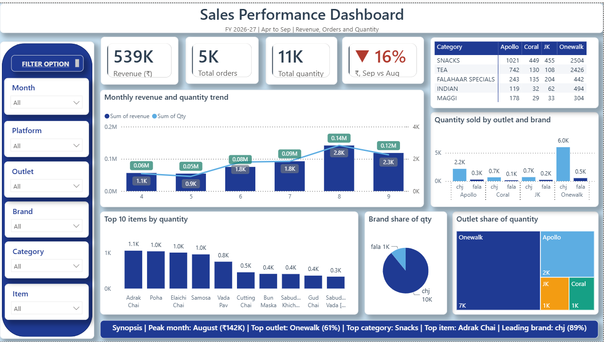

# Multi-Outlet Sales Performance Dashboard

## Overview

This project presents an interactive Power BI dashboard for analyzing sales performance across four outlets: Apollo, Coral, JK, and Onewalk.

The dashboard provides an overview of revenue, order volume, quantity sold, monthly performance, product categories, brands, and top-selling items. It allows users to explore sales performance by month, platform, outlet, brand, category, and item.

The report is designed to make sales information easier to monitor and compare across outlets and product groups.

## Business Objectives

The project focuses on the following business questions:

* How does revenue change from month to month?
* How do order volume and quantity sold vary over time?
* Which outlets contribute the most to total quantity sold?
* Which product categories sell the most?
* Which individual items have the highest sales quantities?
* How do brands contribute to total quantity sold?
* How does sales performance differ across outlets?
* How can filters help users investigate specific products, outlets, and platforms?

## Tools Used

* **Microsoft Power BI** — dashboard development and data visualization
* **Power Query / Data Preparation** — include if used in the project
* **Microsoft Excel** — include if used for the source data or preparation

## Dashboard Preview



## Key Performance Indicators

The dashboard displays the following headline metrics:

| KPI                                 | Displayed Value |
| ----------------------------------- | --------------: |
| Revenue                             |           ₹539K |
| Total Orders                        |              5K |
| Total Quantity Sold                 |             11K |
| September Revenue Change vs. August |            -16% |

These figures reflect the dashboard's displayed reporting period and current filter context.

## Dashboard Analysis

### 1. Monthly Revenue and Quantity Trend

A combined chart compares monthly revenue and quantity sold from April to September in FY 2026–27.

This helps users examine changes in sales performance and identify stronger or weaker months.

### 2. Category Performance by Outlet

The category table compares quantities sold across Apollo, Coral, JK, and Onewalk.

It helps users identify the product categories contributing most to each outlet's sales volume.

### 3. Quantity Sold by Outlet and Brand

This chart compares brand-level quantities across the four outlets.

It provides a view of brand distribution and differences in product movement between locations.

### 4. Top 10 Items by Quantity

The chart ranks items by quantity sold, helping identify products with comparatively high sales volume.

### 5. Brand Share of Quantity

The pie chart shows the contribution of different brands to total quantity sold.

### 6. Outlet Share of Quantity

The treemap compares the quantity contribution of Apollo, Coral, JK, and Onewalk.

It helps users understand how sales volume is distributed across the outlets.

## Interactive Filters

The dashboard includes filters for:

* Month
* Platform
* Outlet
* Brand
* Category
* Item

These filters allow users to investigate sales performance at different levels of detail.

## Summary

The current dashboard highlights August as the peak revenue month, identifies Onewalk as the leading outlet by quantity share, and shows Snacks as the leading category in the displayed summary.

Adrak Chai is identified as the top item by quantity, while the brand chart shows a substantial contribution from the brand labelled `chj`.

These observations describe the current dashboard's displayed results and should be rechecked if the reporting period or filters change.

## Project Structure

```text
multi-outlet-sales-performance-dashboard/
│
├── README.md
├── powerbi/
│   └── ecom_sept_dashboard.pbix
└── screenshots/
    └── sales dashboard.png
```

## How to View the Project

1. Open the dashboard screenshot in the `screenshots` folder to preview the report.
2. Download the Power BI file from the `powerbi` folder.
3. Open the `.pbix` file in Microsoft Power BI Desktop.
4. If the original data source is unavailable, update the data source settings as needed.
5. Use the dashboard filters to explore the available sales data.

## Learning Outcomes

Through this project, I practiced:

* Presenting sales KPIs in a dashboard
* Comparing sales performance across multiple outlets
* Visualizing monthly revenue and quantity trends
* Analyzing product category and brand contributions
* Ranking items by quantity sold
* Using interactive filters for data exploration
* Presenting business observations through visualizations

## Future Improvements

* Add outlet-level revenue and profitability comparisons.
* Include year-over-year comparisons where historical data is available.
* Investigate the reasons behind monthly revenue changes.
* Add clearly defined revenue, order, and quantity measures.
* Improve comparisons between outlets using consistent KPIs.
